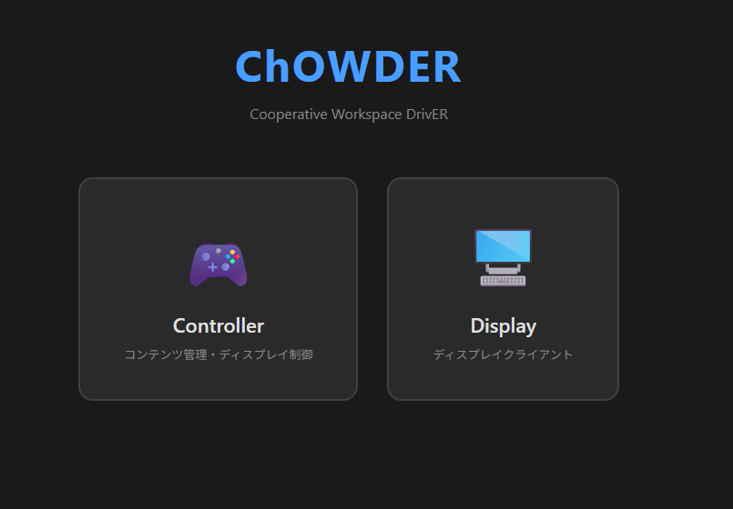

# [ChOWDER2 User Manual](index.html)

## Introduction

This document is intended for all users utilizing ChOWDER2. It explains the operation procedures according to each user's privileges.
Please note that the contents of this document are based on the version currently under development, so some parts may differ from the final product version.

### Initial Screen

Select either Controller or Display.
In the Controller, you can manage content and control displays.
In the Display, it connects as a view-only client and shows the display as a part of a tiled display.