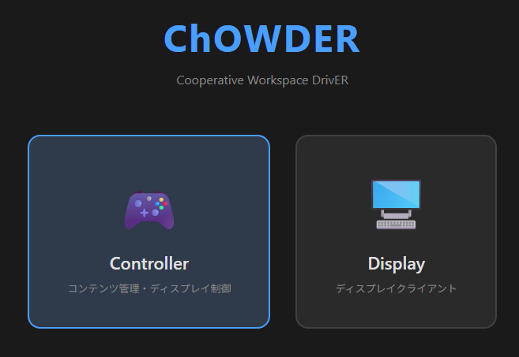
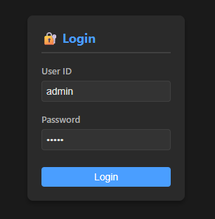
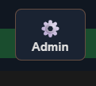
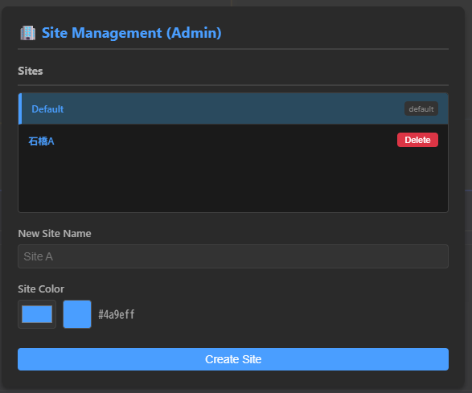
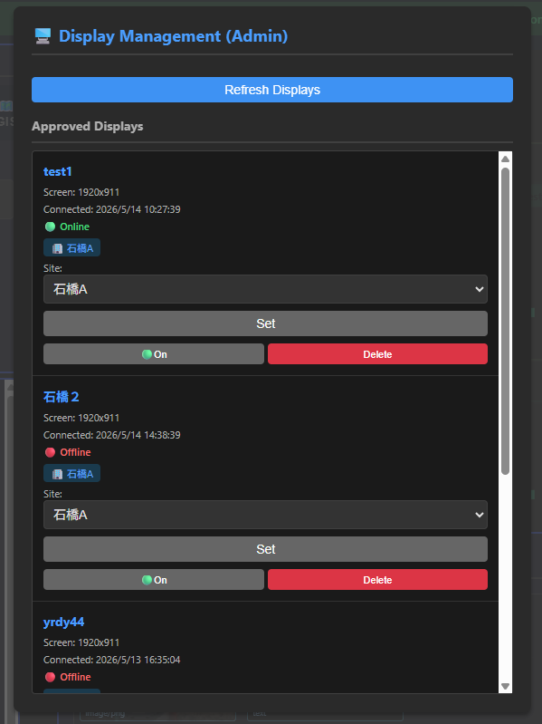
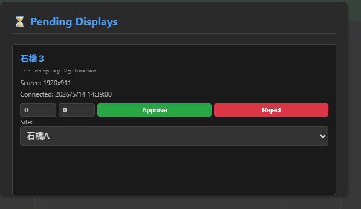
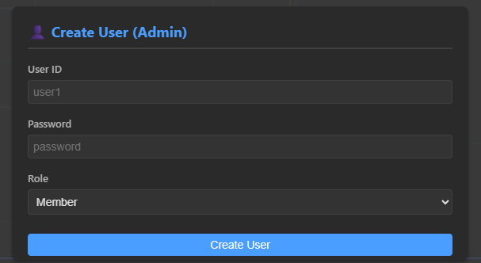

# [ChOWDER2 User Manual](index.html)

## System Administrator: Operation Guide

This procedure is for overall system management (users, infrastructure, and site settings).

### Initial User Settings Upon First Startup

Upon the first startup, an initial user is automatically created.

* Admin: ID/PW = ChOWDERAdministrator

After the first login, please execute the following first for security purposes:

* Create a new Admin user for operations
* Change the password for the initial Admin user (or delete it)

The initial user will not be recreated during a normal restart. Initialization will only be executed again on the next startup if Redis data is deleted.

***

To transition to the system management screen, first connect to the "Controller".

At that time, you must log in with a user that has pre-created "Admin" privileges. 

Next, by pressing  on the top right of the Controller screen after logging in, the administrator screen will be displayed.

***

### System Administrator: Site Registration/Settings Screen

You can register and delete sites.

***

### System Administrator: Display Settings Screen

You can configure settings for displays that have been connected so far.

For each display, you can:
* Show/Hide
* Reassign sites

***

### System Administrator: Display Registration Screen

Registers newly connecting display terminals to the system.

When granting permission to a display, you can simultaneously register it to a Site.

***

### System Administrator: User Management Screen

On this screen, the following operations are possible:

* Create a new user
* Delete
* Change privileges (Administrator/Content Administrator/Display User)

***