# [ChOWDER2 User Manual](index.html)

## Content Administrator: Operation Guide

These are the procedures for uploading content and controlling distribution to displays.

### Login Screen

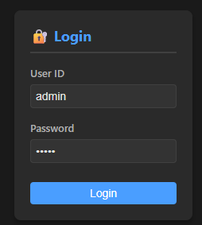

Enter the administrator password in the User ID and Password fields, and press the Login button.
On the screen after logging in, you can perform the following actions:

* Add and delete content
* Move content
* Set display positions

***

### Controller Screen Operations

The controller screen is broadly divided into two functions, which can be switched using the buttons on the top left.

 Switches to the content operation screen. 

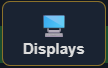 Switches to the display operation screen. 

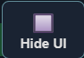 Hides the operation UI while keeping the selected operation screen active. This allows the workspace to be displayed larger. 

Additionally, the following operations are common to both the content and display operation screens:

<Table>
<tr>
<tD>Left mouse button click</td> <td>Select content/display</td>
</tr><tr>
<tD>Left mouse button drag</td> <td>Move the selected content/display</td>
</tr><tr>
<tD>Right mouse button drag </td> <td>Move the entire screen</td>
</tr><tr>
<tD>Mouse wheel scroll</td> <td>Zoom in/out of the entire screen</td>
</tr>
</table>

***

### Content Operation Screen

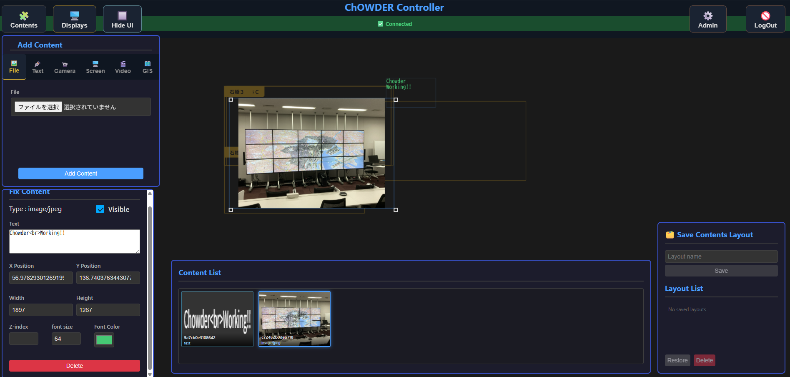

### Adding Content

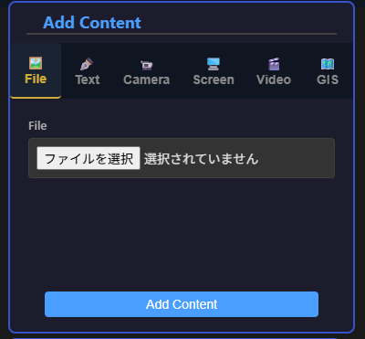

You can register content in the content registration field.
The types of content that can be registered are as follows:

|                       |                                                                                     |
| --------------------- | ----------------------------------------------------------------------------------- |
| 🖼️ File (Image, PDF)   | You can select and upload an image or PDF from your PC.                              |
| ✒️ Text               | You can freely input text and change the text color to add it.                           |
| 📹 Camera             | You can display video from a camera connected to your PC.                            |
| 🖥️ Screen Sharing     | You can display a specific window or the entire screen from your PC.                 |
| 🎬 Video (mp4)         | You can select a video from your PC and stream it.                                   |
| 🗺️ GIS Content        | Displays the GIS operation window, allowing you to show the displayed map content.   |

After selecting the content to add, pressing the "Add Content" button will register the content and distribute it to each display.

***

### Content Management

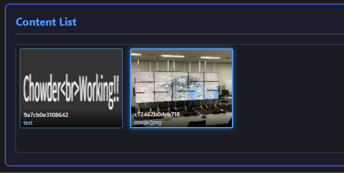

Content that has been processed according to "3.3.1 Adding Content" will be added to the Content List section. The following operations are available in this section:

* Select content
* Toggle content visibility (show/hide)
* Delete selected content

***

### Content Adjustment

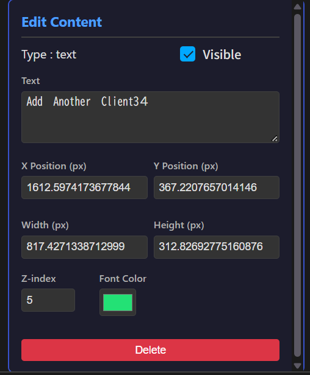

For content selected on the screen or in the content list from 3.3.2, the following operations are available in the adjustment section on the bottom left:

* Toggle content visibility (show/hide)
* Adjust content size and position
* Adjust content stacking order
* Adjust text content, size, and color (text content only)
* Delete

***

### Content Operation Screen

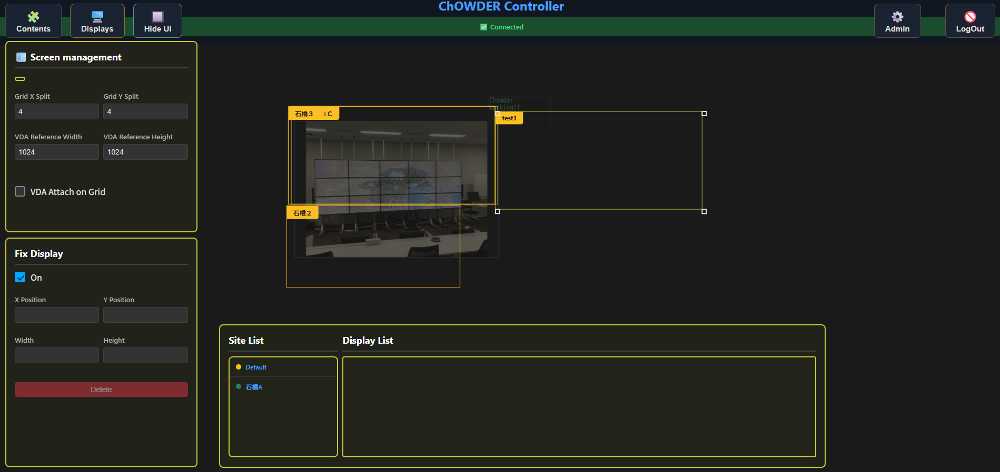

***

### Adding a Display

Adding a display is only possible when there is a connection request from a new display.
When there is a connection request from a new display, the 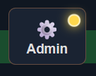 icon will appear in the upper right. Clicking it will automatically transition to the management screen "2.4 Display Registration Screen". By granting permission to the display waiting for connection there, it will be registered as a ChOWDER display.

***

### Virtual Display Management

 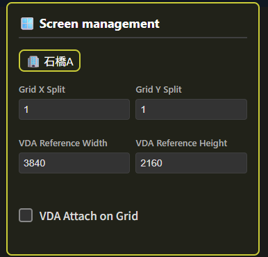

In the virtual display management section, you can change the following settings for the selected site:
* Set vertical/horizontal grid lines
* Virtual display size (vertical/horizontal)
* Enable/disable snapping displays to the grid

***

### Site Display Management

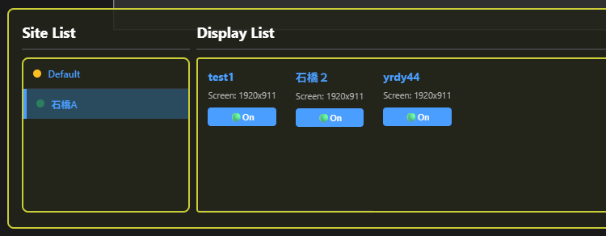

Items processed according to "3.4.1 Adding a Display" will be added to the Display List section. The following operations are available in this section:
* Select a display
* Toggle visibility of the selected display (show/hide)

***

### Display Management

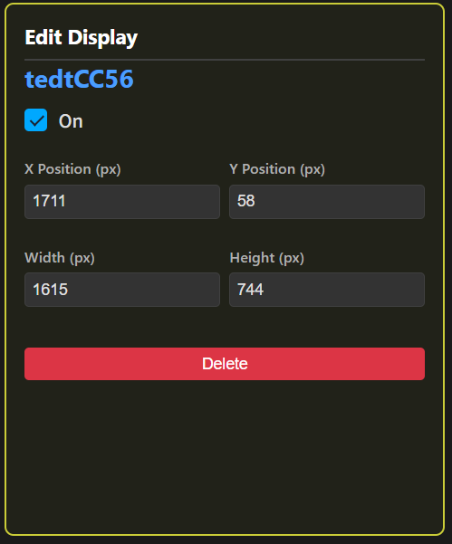

For displays selected on the screen or in the content list from 4.3.3, the following operations are available in the adjustment section on the bottom left:

* Toggle display visibility (show/hide)
* Adjust display size and position
* Delete