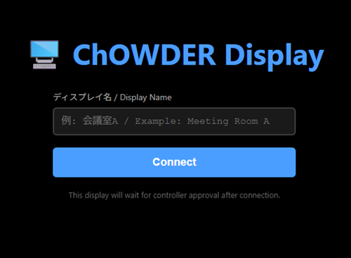
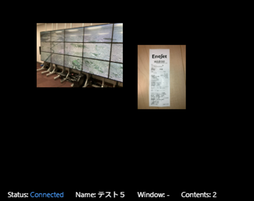

# [ChOWDER2 User Manual](index.html)

## Display User: Operation Guide

This is the procedure for connecting a display terminal to the system and checking the display.

### Login Screen

By entering the display name you wish to register and pressing the "Connect" button, it will enter a "Waiting for display registration" state.
Once the display registration process is completed by an administrator, it will be shown as a display.

***

### Viewing the Display Screen

There are no further operations that the user can perform on the display screen.